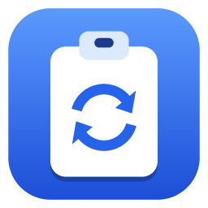
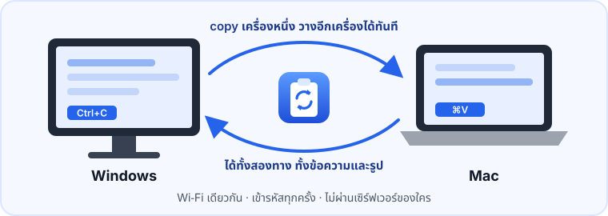
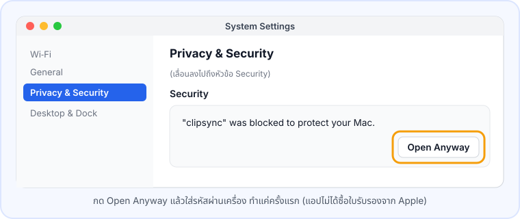
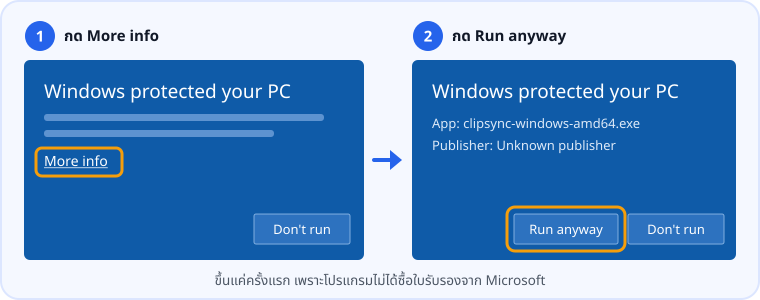
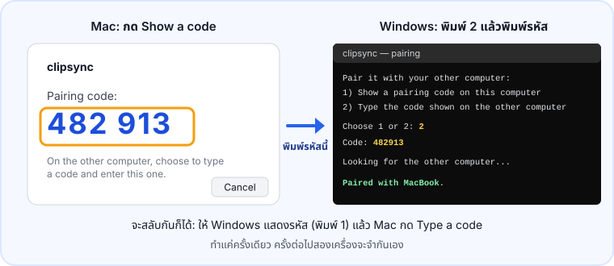
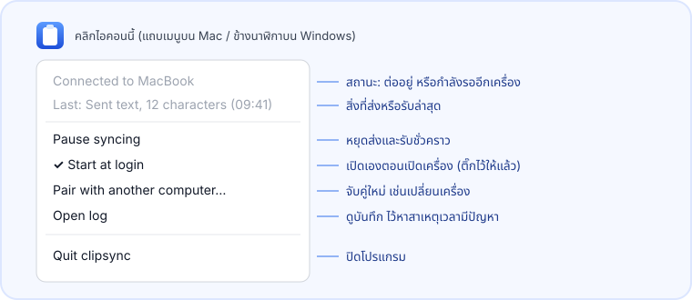

<p align="center"></p>

<h1 align="center">clipsync</h1>

<p align="center">
  <b>copy บน Windows แล้ววางบน Mac ได้ทันที และกลับกัน</b><br>
  Copy on one computer, paste on the other — Windows ⇄ Mac, on the same Wi-Fi.
</p>

<p align="center">
  <a href="https://github.com/tobsatop/clipsync/releases/latest/download/clipsync-windows-amd64.exe"><b>⬇ ดาวน์โหลดสำหรับ Windows</b></a>
  &nbsp;&nbsp;·&nbsp;&nbsp;
  <a href="https://github.com/tobsatop/clipsync/releases/latest/download/clipsync-mac.zip"><b>⬇ ดาวน์โหลดสำหรับ Mac</b></a>
</p>

<p align="center"></p>

- ส่งได้ทั้งข้อความ (ภาษาไทยได้) และรูป เช่น ภาพหน้าจอ
- ไม่ต้องสมัคร ไม่มีเซิร์ฟเวอร์ ข้อมูลเข้ารหัสและส่งตรงกันภายในบ้าน
- เปิดเครื่องแล้วทำงานเอง ไม่ต้องเปิดหน้าต่างค้างไว้

## ติดตั้ง

ใช้เวลาประมาณ 5 นาที ต้องมีคอม Windows กับ Mac ที่ต่อ Wi-Fi วงเดียวกัน

### 1. ติดตั้งบน Mac

1. กด **[ดาวน์โหลดสำหรับ Mac](https://github.com/tobsatop/clipsync/releases/latest/download/clipsync-mac.zip)** แล้วดับเบิลคลิกไฟล์ zip ที่ได้
2. ลาก **clipsync** ไปไว้ในโฟลเดอร์ **Applications** แล้วดับเบิลคลิกเปิด
3. ครั้งแรก macOS จะขึ้นว่าเปิดไม่ได้ ให้กด **Done** แล้วไปที่ **System Settings → Privacy & Security** เลื่อนลงไปแล้วกด **Open Anyway** (ทำแค่ครั้งแรก)

   

4. ถ้าขึ้นถามเรื่อง **Local Network** ให้กด **Allow**

### 2. ติดตั้งบน Windows

1. กด **[ดาวน์โหลดสำหรับ Windows](https://github.com/tobsatop/clipsync/releases/latest/download/clipsync-windows-amd64.exe)**
   - ถ้าเบราว์เซอร์เตือนว่าไฟล์ไม่ค่อยมีคนโหลด ให้เลือก **Keep** (ใน Edge อยู่ในปุ่ม **…** ข้างชื่อไฟล์)
2. ดับเบิลคลิกไฟล์ที่ได้ ถ้าขึ้นจอสีฟ้า ให้กด **More info** แล้วกด **Run anyway** (ทำแค่ครั้งแรก)

   

3. ถ้าขึ้นหน้าต่าง Firewall ให้กด **Allow**

### 3. จับคู่สองเครื่อง (ครั้งเดียว)

หลังเปิดครั้งแรก ทั้งสองเครื่องจะขึ้นหน้าต่างให้จับคู่

1. บน Mac กด **Show a code** จะได้รหัส 6 หลัก
2. บน Windows พิมพ์ `2` กด Enter แล้วพิมพ์รหัสนั้น กด Enter



### เสร็จแล้ว

copy บนเครื่องหนึ่ง แล้วไปวางอีกเครื่องได้เลย
- ไอคอน clipboard สีฟ้าข้างนาฬิกา (Windows) หรือแบบทึบบนแถบเมนู (Mac) แปลว่าสองเครื่องต่อกันอยู่
- ครั้งต่อไปเปิดเครื่องแล้ว clipsync ทำงานเอง ไม่ต้องทำอะไรอีก

## เมนู

คลิกไอคอน clipsync เพื่อดูสถานะ หยุดชั่วคราว หรือจับคู่ใหม่



## คำถามที่พบบ่อย

<details>
<summary><b>ต่อไม่ติด ไอคอนขึ้นว่า Waiting for ...</b></summary>

- เช็กว่าสองเครื่องต่อ Wi-Fi วงเดียวกัน
- Windows: อนุญาต clipsync ใน Firewall (Windows Security → Firewall & network protection → Allow an app through firewall)
- Mac: เปิด Local Network ให้ clipsync (System Settings → Privacy & Security → Local Network)
- ลองเลือก **Quit clipsync** ในเมนูแล้วเปิดใหม่ทั้งสองเครื่อง
- ดูสาเหตุได้ที่ **Open log** ในเมนู
</details>

<details>
<summary><b>หน้าต่างจับคู่ไม่ขึ้น หรือเผลอปิดไป</b></summary>

คลิกไอคอน clipsync แล้วเลือก **Pair with another computer...** จะสลับกันก็ได้ ให้เครื่องไหนแสดงรหัสก็ได้ ใส่รหัสผิดได้ 3 ครั้ง จากนั้นต้องขอรหัสใหม่
</details>

<details>
<summary><b>หาไอคอนบน Windows ไม่เจอ</b></summary>

กดลูกศร **^** ข้างนาฬิกาขวาล่าง ไอคอนสีฟ้ารูป clipboard จะอยู่ในนั้น ลากออกมาวางข้างนาฬิกาได้ถ้าอยากเห็นตลอด
</details>

<details>
<summary><b>คอม Windows เป็นชิป ARM (เช่น Snapdragon)</b></summary>

ใช้ไฟล์ [clipsync-windows-arm64.exe](https://github.com/tobsatop/clipsync/releases/latest/download/clipsync-windows-arm64.exe) แทน ถ้าไม่แน่ใจ ใช้ไฟล์ปกติ ซึ่งใช้ได้กับคอมส่วนใหญ่
</details>

<details>
<summary><b>อัปเดตเป็นรุ่นใหม่</b></summary>

สองเครื่องต้องใช้รุ่นเดียวกัน ไม่ต้องจับคู่ใหม่

- **Mac:** เลือก Quit clipsync ในเมนู แล้วเอาตัวใหม่ไปวางทับใน Applications แล้วเปิด
- **Windows:** เลือก Quit clipsync ในเมนู แล้วดับเบิลคลิกไฟล์ตัวใหม่
</details>

<details>
<summary><b>เลิกใช้ / ถอนการติดตั้ง</b></summary>

- **Mac:** เอาติ๊ก Start at login ออก เลือก Quit clipsync แล้วลบ clipsync ออกจาก Applications
- **Windows:** เอาติ๊ก Start at login ออก เลือก Quit clipsync แล้วลบโฟลเดอร์ `%LocalAppData%\Programs\clipsync`
</details>

<details>
<summary><b>ทำอะไรไม่ได้บ้าง</b></summary>

- copy ไฟล์ (ใน Finder หรือ Explorer) จะไม่ถูกส่ง
- ถ้าสิ่งที่ copy มีทั้งข้อความและรูป เช่นช่องตาราง Excel จะส่งเฉพาะข้อความ
- รหัสผ่านที่ copy จากโปรแกรมเก็บรหัสผ่านจะไม่ถูกส่ง (ตั้งใจไว้)
- ใช้กับคอมสองเครื่อง ที่อยู่ใน Wi-Fi เดียวกันเท่านั้น
- Mac ต้องเป็นชิป Apple (M1 ขึ้นไป) และรูปใหญ่สุด 40 MB
</details>

<details>
<summary><b>ปลอดภัยไหม ทำไมเครื่องเตือนตอนเปิด</b></summary>

- เครื่องเตือนเพราะโปรแกรมไม่ได้ซื้อใบรับรองจาก Apple หรือ Microsoft ซึ่งมีค่าใช้จ่ายรายปี โค้ดทั้งหมดเปิดให้ดูได้ใน repo นี้ และไฟล์ดาวน์โหลดสร้างจากโค้ดนี้โดย GitHub เอง
- ข้อมูลส่งตรงระหว่างสองเครื่องเท่านั้น และเข้ารหัสทุกครั้ง (จับคู่ด้วย CPace, เข้ารหัสด้วย X25519 + AES-256-GCM)
- เป็นโปรเจกต์ส่วนตัว ยังไม่ผ่านการตรวจโดยผู้เชี่ยวชาญด้านความปลอดภัย ใช้ตามความเสี่ยงของตัวเอง
</details>

## สำหรับนักพัฒนา

<details>
<summary>build, ทดสอบ, ออกรุ่นใหม่ และโครงสร้างโค้ด</summary>

```sh
go test -race ./...
./scripts/build.sh        # dist/clipsync.app, dist/clipsync-windows-{amd64,arm64}.exe
# ทดสอบกับ clipboard จริงบน Mac (จะเก็บและคืนของที่ copy ไว้ให้)
CLIPSYNC_REAL_CLIPBOARD=1 go test -run TestRealMac ./internal/node/
```

**ออกรุ่นใหม่:** แก้ `version` ใน `main.go` แล้ว commit จากนั้น `git tag v0.3.1 && git push origin v0.3.1` แล้ว GitHub Actions (`.github/workflows/release.yml`) จะทดสอบ build และสร้างหน้า Release ให้เอง

**คำสั่ง** (Mac: `/Applications/clipsync.app/Contents/MacOS/clipsync`)

| คำสั่ง | ทำอะไร |
|---|---|
| `clipsync` | เปิดเป็นไอคอน (แบบดับเบิลคลิก) |
| `clipsync run` | sync ในหน้าต่างนี้พร้อม log สด (ปิดตัวที่เป็นไอคอนก่อน) |
| `clipsync status` | ดูว่าจับคู่กับเครื่องไหน |
| `clipsync pair` / `clipsync pair 123456` | จับคู่แบบแสดงรหัส / พิมพ์รหัส |
| `clipsync unpair` | ลบการจับคู่ |
| `-peer IP` | ระบุ IP ของอีกเครื่องเอง ถ้าหากันไม่เจอ |
| `-v` | log ละเอียด |

**หลักการ:** หากันด้วย UDP broadcast (พอร์ต 47801), เชื่อมต่อทาง TCP (พอร์ต 47800), จับคู่ด้วย CPace (PAKE) แล้วทุกการเชื่อมต่อใช้กุญแจใหม่จากกุญแจจับคู่ผสม X25519 เข้ารหัสด้วย AES-256-GCM แยกแต่ละทิศทาง ข้อมูลตั้งค่าและกุญแจอยู่ที่ `~/Library/Application Support/clipsync` (Mac) และ `%AppData%\clipsync` (Windows)

**โครงสร้างโค้ด**
- `main.go`, `pairing.go`: คำสั่งและขั้นตอนจับคู่
- `tray*.go`, `lock_*.go`: ไอคอน เมนู เปิดเองตอนล็อกอิน และกันเปิดซ้อน
- `internal/wire`: จับคู่และการเชื่อมต่อแบบเข้ารหัส
- `internal/node`: ดู clipboard, ส่ง/รับ, ต่อใหม่อัตโนมัติ, กันส่งวนซ้ำ
- `internal/lan`: หาอีกเครื่องใน Wi-Fi
- `internal/clip`: อ่าน/เขียน clipboard ของแต่ละระบบ
- `internal/icons`, `tools/genicons`, `docs/`: ไอคอนและภาพประกอบ
</details>

## License

MIT — ดู [LICENSE](LICENSE)
